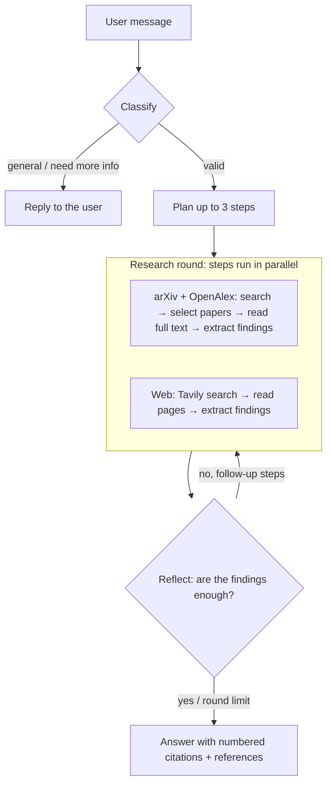

# Deep Research

## Overview

A **multi-agent AI research assistant** powered by [Gemini](https://ai.google.dev/gemini-api/docs/models), built with [Google ADK](https://github.com/google/adk-python). It plans the research, reads academic papers and web pages, digs deeper where the findings are incomplete, and answers with citations to the sources it actually read.

## Workflow



1. **Classification** - Decides whether the latest message is a research question (including factual and news questions), needs clarification, or is out of scope. It reads the previous turns, so follow-ups and clarifications are turned into a self-contained question
2. **Planning** - Creates up to 3 independent steps, each with a tool, a query in that tool's syntax (arXiv API syntax for papers, keywords for the web) and a goal
3. **Research** - Runs the steps in parallel; every source is read in full and turned into structured findings (claim + verbatim evidence):
   - **ArXiv**: collects candidates from the arXiv search (30, ranked by text relevance; the query is relaxed if it returns nothing) and from [OpenAlex](https://openalex.org/) (the 15 most cited arXiv papers matching the query, which the text search often misses), adds citation counts, lets the model select the 3 most relevant from title, abstract, date and citations, downloads their full text (arXiv HTML, PDF as fallback) and extracts findings from each paper
   - **Web**: searches with [Tavily](https://tavily.com/) including the page text, and extracts findings from each page
4. **Reflection** - Reviews the findings and, if important gaps remain, plans follow-up steps for another round (2 rounds by default)
5. **Answer Synthesis** - Writes the answer from the findings only, citing sources as `[n]`; the references section is generated from the source metadata, listing only the sources actually cited

A failing source or step (network error, rate limit, model error) is logged and skipped: the run continues with the rest.

## Getting Started

### Prerequisites

- `Python 3.11+` and [`uv`](https://docs.astral.sh/uv/)
- API keys:
  - `Google AI API key` (for Gemini models)
  - `Tavily API key` (for web search)

A research run makes roughly 15-20 model requests (more with a second round): about 5 go to `MODEL` (classification, planning, reflection, answer) and the rest to `FAST_MODEL` (paper selection and extraction, `gemini-flash-lite-latest` by default). The Gemini free tier has a small daily quota per model, so it allows only a few runs per day; use a paid key for regular use.

OpenAlex works without a key on a small daily budget shared by IP address; for regular use, get a free key at [openalex.org](https://openalex.org/settings/api) and set `OPENALEX_API_KEY`.

### Setup

1. **Clone the repository:**
   ```bash
   git clone https://github.com/lorenzofavaro/deep-research.git
   cd deep-research
   ```

2. **Install dependencies:**
   ```bash
   uv sync
   ```

3. **Configure environment variables:**

   Copy the example environment file and set your API keys:
   ```bash
   cp multi_tool_agent/.env.example multi_tool_agent/.env
   ```

   Optional variables select the models (`MODEL`, `FAST_MODEL`), the OpenAlex key and the research limits (steps, rounds, papers, pages); see [`.env.example`](multi_tool_agent/.env.example).

4. **Execute the research system:**

   ```bash
   uv run adk run multi_tool_agent
   ```

   or use the ADK web UI, which also shows the events of each agent:
   ```bash
   uv run adk web
   ```

5. **Run the tests:**

   ```bash
   uv run pytest
   ```

   The tests run the whole workflow offline, with a scripted model and stubbed search tools, so they need no API keys.

6. **Smoke test against the real APIs:**

   ```bash
   uv run python evals/smoke.py
   ```

   It runs 3 simple questions (a current fact, a well-known paper, a mixed question) with minimal research budgets, about 5-8 model calls each, so it fits the Gemini free tier. It checks that each run completes, that every step finds something and that every citation has a reference, and it reports model calls, tokens and time. Use `--questions FILE` for your own questions and `--full-budget` for the configured budgets. Reports are saved in `evals/out/<system>/idx-<n>.md`, the layout used by [DeepResearch Bench II](https://github.com/imlrz/DeepResearch-Bench-II).

## Usage Examples

### Basic Research Query
- *Who is the current president of the USA?*
- *Tell me the latest news on Elon Musk*
- *What are the latest developments in transformer architecture optimization?*

### Domain-Specific Research
- *How do quantum computing algorithms compare to classical machine learning for optimization problems?*
- *What are the current applications of CRISPR technology in treating genetic disorders?*
- *What are the latest developments in renewable energy storage solutions?*

https://github.com/user-attachments/assets/b72a65c0-4c1c-4474-9519-9c96f4254783
