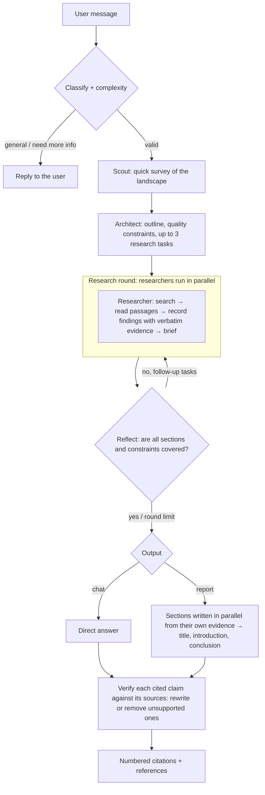

# Deep Research

## Overview

A **multi-agent AI research assistant** powered by [Gemini](https://ai.google.dev/gemini-api/docs/models), built with [Google ADK](https://github.com/google/adk-python) 2.x as a graph workflow. It plans the research, reads academic papers and web pages, digs deeper where the findings are incomplete, and answers with citations to the sources it actually read.

## Workflow



1. **Classification** - Decides whether the latest message is a research question (including factual and news questions), needs clarification, or is out of scope, and estimates its complexity. It reads the previous turns, so follow-ups and clarifications are turned into a self-contained question
2. **Scouting** - Except for simple questions, a scout (a researcher with a 3-call budget) maps the landscape: sub-topics, key terms, landmark papers and authoritative sources. Its findings are kept for the answer
3. **Planning** - An architect designs the answer from the scout's survey: the outline (sections with the questions they must answer), 2-4 checkable quality constraints, and up to 3 independent research tasks, like a lead researcher briefing colleagues: an objective, where to look (papers, web), a lens (evidence, comparator, critic, horizon), boundaries so researchers do not overlap, and the sections each task serves. Simple questions get one task
4. **Research** - Each task goes to an autonomous researcher with its own context, tools and search budget (10 search/read calls, 5 for simple questions):
   - `search_papers`: arXiv search plus the most cited matching papers from [OpenAlex](https://openalex.org/), with citation counts; paper metadata always comes from arXiv
   - `web_search`: [Tavily](https://tavily.com/) search, including the page text
   - `read_source`: the passages of a paper (arXiv HTML, PDF as fallback) or page most relevant to what the researcher is looking for
   - `record_finding`: a claim with a quote from the source, tagged with the outline section it serves; rejected unless the quote is (nearly) verbatim
   - `think`: a pause to assess progress

   Raw source text stays with the researcher: it returns only its findings and a short brief. Once the budget is exhausted the search tools are removed, so the researcher wraps up
5. **Coverage check** - Reviews the findings per section against the outline and the quality constraints and, if important gaps remain, delegates follow-up tasks for another round (2 rounds by default); it can also revise the outline
6. **Answer Synthesis** - Writes the answer from the findings only, citing sources as `[n]`; the references section is generated from the source metadata, listing only the sources actually cited. Two formats, chosen by the classifier (or forced with `OUTPUT_MODE=chat|report`):
   - **chat**: a direct answer, for questions
   - **report**: for requests of a report, review or in-depth analysis, each outline section is written in parallel from the findings tagged for it (plus the unassigned ones), then an editor adds the title, the executive summary and the conclusion
7. **Verification** - Every sentence, list item or table row with a citation is checked against the findings (claim and verbatim evidence) of the sources it cites: partially supported claims are rewritten to what the evidence supports, unsupported ones rewritten or removed, and citations to unknown sources dropped. The share of supported claims is recorded with the run (`VERIFY=false` disables the step)

A failing source or step (network error, rate limit, model error) is logged and skipped: the run continues with the rest. `MODEL` and `FAST_MODEL` accept comma-separated chains of models: when a model fails with a quota, rate-limit or server error, the next one in the chain takes over (by default `gemini-flash-latest` and `gemini-flash-lite-latest` back each other up).

## Getting Started

### Prerequisites

- `Python 3.11+` and [`uv`](https://docs.astral.sh/uv/)
- API keys:
  - `Google AI API key` (for Gemini models)
  - `Tavily API key` (for web search)

A research run makes roughly 15-40 model requests, depending on the number of researchers and rounds: about 5 go to `MODEL` (classification, planning, reflection, answer) and the rest to `FAST_MODEL` (the researchers). The Gemini free tier has a small daily quota per model, so it allows only a few runs per day; use a paid key for regular use.

OpenAlex works without a key on a small daily budget shared by IP address; for regular use, get a free key at [openalex.org](https://openalex.org/settings/api) and set `OPENALEX_API_KEY`.

### Setup

1. **Clone the repository:**
   ```bash
   git clone https://github.com/lorenzofavaro/deep-research.git
   cd deep-research
   ```

2. **Install dependencies:**
   ```bash
   uv sync
   ```

3. **Configure environment variables:**

   Copy the example environment file and set your API keys:
   ```bash
   cp multi_tool_agent/.env.example multi_tool_agent/.env
   ```

   Optional variables select the models (`MODEL`, `FAST_MODEL`), the OpenAlex key and the research limits (steps, rounds, papers, pages); see [`.env.example`](multi_tool_agent/.env.example).

4. **Execute the research system:**

   ```bash
   uv run adk run multi_tool_agent
   ```

   or use the ADK web UI, which also shows the events of each agent:
   ```bash
   uv run adk web
   ```

5. **Run the tests:**

   ```bash
   uv run pytest
   ```

   The tests run the whole workflow offline, with a scripted model and stubbed search tools, so they need no API keys.

6. **Smoke test against the real APIs:**

   ```bash
   uv run python evals/smoke.py
   ```

   It runs 3 simple questions (a current fact, a well-known paper, a mixed question) with minimal research budgets (one round, at most two researchers with 4 search/read calls each: about 8-15 model calls per question), so it fits the Gemini free tier. It checks that each run completes, that the researchers find something and that every citation has a reference, and it reports model calls, tokens and time. Use `--questions FILE` for your own questions and `--full-budget` for the configured budgets. Reports are saved in `evals/out/<system>/idx-<n>.md`, the layout used by [DeepResearch Bench II](https://github.com/imlrz/DeepResearch-Bench-II).

## Usage Examples

### Basic Research Query
- *Who is the current president of the USA?*
- *Tell me the latest news on Elon Musk*
- *What are the latest developments in transformer architecture optimization?*

### Domain-Specific Research
- *How do quantum computing algorithms compare to classical machine learning for optimization problems?*
- *What are the current applications of CRISPR technology in treating genetic disorders?*
- *What are the latest developments in renewable energy storage solutions?*

https://github.com/user-attachments/assets/b72a65c0-4c1c-4474-9519-9c96f4254783
